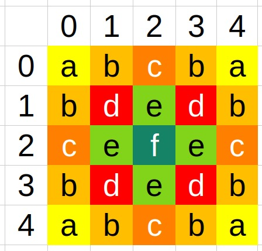
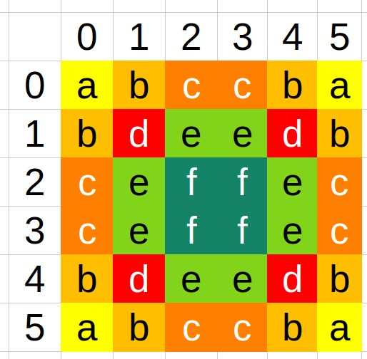
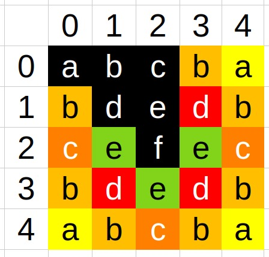
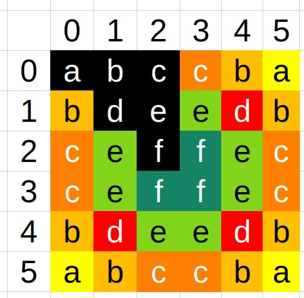

# **Problema do Passeio do Cavalo**

[](https://github.com/davidalain/PasseioDoCavaloTabuleiroNxN/actions/workflows/ci.yml)

O **Problema do Passeio do Cavalo** é um problema clássico da matemática e da ciência da computação,
relacionado ao movimento do cavalo no tabuleiro de xadrez.

Dado um tabuleiro de xadrez (_normalmente de 8x8 casas_), o problema pergunta:

&nbsp;&nbsp;&nbsp;&nbsp;É possível mover um cavalo pelo tabuleiro de forma que ele visite cada casa exatamente uma vez?

Esse percurso é chamado de passeio do cavalo ([Knight's tour](https://en.wikipedia.org/wiki/Knight%27s_tour)).

O código deste repositório fornece diferentes implementações em **Java**, desenvolvidas pelo [Prof. David Alain do Nascimento](https://github.com/davidalain),
que calculam a quantidade de passeios possíveis num tabuleiro de dimensão **N**x**N** usando técnicas de programação paralela e concorrente.

A quantidade de soluções desse problema é conhecida na literatura. A proposta deste repositório é exemplificar as técnicas que podem ser usadas para implementar a solução.

Fonte: [Number of tours - Knight's tour](https://en.wikipedia.org/wiki/Knight%27s_tour#Number_of_tours) (sequência [OEIS A165134](https://oeis.org/A165134))

| N | Quantidade de passeios possíveis | Tempo de cálculo (`Solucao7`) |
| - | -------------------------------- | ----------------------------- |
| 1 | 1                                | 0,2 ms                        |
| 2 | 0                                | 0,2 ms                        |
| 3 | 0                                | 0,3 ms                        |
| 4 | 0                                | 4,7 ms                        |
| 5 | 1 728                            | 266 ms                        |
| 6 | 6 637 920                        | 49 min 29 s                   |
| 7 | 165 575 218 320                  | ~1,6 a 7 anos _(estimativa)_  |
| 8 | 19 591 828 170 979 904           | ~190 mil a 850 mil anos _(estimativa)_ |

**Como os tempos foram obtidos** (Intel Core i7-10750H, 6 núcleos / 12 threads, Java 21):

- **N = 1 a 5:** mediana de 10 execuções, depois de aquecer a JVM.
- **N = 6:** uma execução, que confirmou o total de 6 637 920.
- **N = 7 e 8:** estimados a partir das medições, sem executar.
  - No 6x6, a busca levou em média **2,46 ms por passeio encontrado**; no 5x5, 0,55 ms (4,4 vezes menos).
  - Cada casa buscada representa no máximo 8 casas simétricas, então a busca precisa achar pelo menos 1/8 do total de passeios.
  - O limite inferior supõe o custo por passeio do 6x6. O superior supõe que ele cresça de novo 4,4 vezes, como do 5x5 para o 6x6.

> O tempo cresce muito rápido: o 5x5 sai em fração de segundo, o 6x6 leva quase uma hora, o 7x7 levaria anos
> e o 8x8 é inviável por busca exaustiva. A API aceita, por padrão, até **N = 7**. Por isso o cálculo é **assíncrono**:
> a requisição só inicia o cálculo, e o andamento e o resultado são consultados depois. Para o 7x7, defina um
> tempo máximo (`PASSEIO_TEMPO_MAXIMO`).

## **As soluções**

Cada classe em [`solucao/`](src/main/java/br/com/davidalain/passeiocavalo/solucao) é um passo da evolução da técnica.
O código de cada uma tem comentários que explicam a lógica em detalhe.

| Classe | O que faz | Técnica |
| ------ | --------- | ------- |
| [`Solucao1`](src/main/java/br/com/davidalain/passeiocavalo/solucao/Solucao1.java) | Encontra **um** passeio | Busca gulosa com a heurística de Warnsdorff. Rápida, mas pode falhar (não volta atrás) |
| [`Solucao2`](src/main/java/br/com/davidalain/passeiocavalo/solucao/Solucao2.java) | Encontra **um** passeio | Backtracking + Warnsdorff. Sempre encontra, se existir |
| [`Solucao3`](src/main/java/br/com/davidalain/passeiocavalo/solucao/Solucao3.java) | Conta **todos** e guarda numa árvore | Busca exaustiva com `parallelStream()` em todos os níveis |
| [`Solucao4`](src/main/java/br/com/davidalain/passeiocavalo/solucao/Solucao4.java) | Conta todos e guarda numa árvore | Paraleliza só o topo da busca (tarefas maiores, menos custo de coordenação) |
| [`Solucao5`](src/main/java/br/com/davidalain/passeiocavalo/solucao/Solucao5.java) | Conta todos e guarda numa árvore | Casas visitadas em uma máscara de bits (`long`) no lugar de `boolean[][]` |
| [`Solucao6`](src/main/java/br/com/davidalain/passeiocavalo/solucao/Solucao6.java) | Só conta | Sem árvore e sem estado compartilhado: cada chamada retorna sua soma (`long`) |
| [`Solucao7`](src/main/java/br/com/davidalain/passeiocavalo/solucao/Solucao7.java) | Conta todas as casas do tabuleiro | Solução 6 + simetria: busca só as casas "espelho original" (6 de 25 no 5x5, 10 de 49 no 7x7). Pode ser acompanhada e cancelada. **É a usada pela API** |

As soluções 5, 6 e 7 suportam tabuleiros de até 8x8 (64 casas = 64 bits de um `long`).

---

## **Poda por posições espelho (simetria)**

A `Solucao7` não faz a busca a partir de todas as casas do tabuleiro. Ela usa a simetria do quadrado para
**podar casas iniciais inteiras**: só busca uma casa de cada grupo de casas simétricas e copia o resultado para as outras.

### A ideia

Um tabuleiro quadrado continua igual depois de **8 transformações**: 4 rotações (0°, 90°, 180° e 270°) e
4 reflexões (no eixo horizontal, no vertical e nas duas diagonais). Uma transformação dessas leva um passeio
do cavalo em outro passeio, porque o salto em "L" continua sendo um salto em "L" depois de girado ou refletido.

Por isso, **casas simétricas têm exatamente a mesma quantidade de passeios**. Se partindo do canto (0,0)
existem 304 passeios, partindo dos outros três cantos também existem 304: cada passeio de um canto, girado,
vira um passeio do outro.

Nas imagens abaixo, casas com a **mesma letra** formam um grupo de casas simétricas, e todas têm a mesma
quantidade de passeios:

<table>
  <tr>
    <th>5x5: grupos de casas simétricas</th>
    <th>6x6: grupos de casas simétricas</th>
  </tr>
  <tr>
    <td></td>
    <td></td>
  </tr>
</table>

### Quais casas são buscadas

De cada grupo basta buscar **uma** casa: o "espelho original" (método
[`Posicao.posicaoEspelhoOriginal`](src/main/java/br/com/davidalain/passeiocavalo/model/Posicao.java)).
Para encontrá-lo, a casa é refletida até cair no triângulo do quadrante superior esquerdo:

1. **Reflexão horizontal:** se a linha está na metade de baixo (`linha >= ⌈N/2⌉`), vira `N - linha - 1`;
2. **Reflexão vertical:** se a coluna está na metade da direita (`coluna >= ⌈N/2⌉`), vira `N - coluna - 1`;
3. **Reflexão na diagonal principal:** se `linha > coluna`, troca linha e coluna.

O resultado sempre fica no triângulo com `linha <= coluna`, dentro do quadrante superior esquerdo. Essas são
as casas em **preto** nas imagens, as únicas em que a busca roda:

<table>
  <tr>
    <th>5x5: 6 casas buscadas de 25</th>
    <th>6x6: 6 casas buscadas de 36</th>
  </tr>
  <tr>
    <td></td>
    <td></td>
  </tr>
</table>

Exemplos no 5x5 (⌈5/2⌉ = 3):

| Casa | Passo 1 (linha) | Passo 2 (coluna) | Passo 3 (diagonal) | Espelho original |
| ---- | --------------- | ---------------- | ------------------ | ---------------- |
| (4,4) | 4 → 0: (0,4) | 4 → 0: (0,0) | — | (0,0) = **a** |
| (3,0) | 3 → 1: (1,0) | — | troca: (0,1) | (0,1) = **b** |
| (2,4) | — | 4 → 0: (2,0) | troca: (0,2) | (0,2) = **c** |
| (2,3) | — | 3 → 1: (2,1) | troca: (1,2) | (1,2) = **e** |

### O cálculo em duas fases

A [`Solucao7`](src/main/java/br/com/davidalain/passeiocavalo/solucao/Solucao7.java) faz o cálculo em duas fases:

1. **Busca, em paralelo, só nas casas representantes** (as casas em preto);
2. **Preenche as demais casas** copiando o valor do seu espelho original, sem nenhuma busca nova.

No 5x5, por exemplo, a busca roda em apenas 6 casas. O total sai da soma de cada grupo, multiplicando
os passeios do representante pelo tamanho do grupo:

| Grupo | Representante | Casas no grupo | Passeios por casa | Subtotal |
| :---: | :-----------: | :------------: | ----------------: | -------: |
| a | (0,0) | 4 | 304 | 1 216 |
| b | (0,1) | 8 | 0 | 0 |
| c | (0,2) | 4 | 56 | 224 |
| d | (1,1) | 4 | 56 | 224 |
| e | (1,2) | 4 | 0 | 0 |
| f | (2,2) | 1 | 64 | 64 |
| | | **25** | | **1 728** |

### Quanto a poda economiza

Com k = ⌈N/2⌉, a busca roda em k·(k+1)/2 casas, em vez de N²:

| N | Casas do tabuleiro | Casas buscadas | Busca roda em |
| - | -----------------: | -------------: | ------------: |
| 4 | 16 | 3 | 19% das casas |
| 5 | 25 | 6 | 24% das casas |
| 6 | 36 | 6 | 17% das casas |
| 7 | 49 | 10 | 20% das casas |
| 8 | 64 | 10 | 16% das casas |

A economia é um pouco menor que 1/8 porque nem todo grupo tem 8 casas. As casas que ficam sobre as diagonais
ou sobre as linhas centrais coincidem com o próprio reflexo, e o grupo fica com 4 casas (ou só 1, no centro
dos tabuleiros de lado ímpar). Os cantos, por exemplo, formam grupos de 4.

---

## **Tutorial: como executar o projeto**

### 1. Pré-requisitos

Escolha **uma** das opções:

- **Java (JDK) 21** — o Maven não precisa ser instalado, porque o projeto traz o Maven Wrapper (`./mvnw`);
- **Docker** — não precisa de Java na máquina.

Confira o Java com:

```bash
java -version
```

### 2. Baixar o código

```bash
git clone https://github.com/davidalain/PasseioDoCavaloTabuleiroNxN.git
cd PasseioDoCavaloTabuleiroNxN
```

### 3. Rodar os testes

Os testes verificam todas as soluções em tabuleiros de 1x1 a 5x5 e todos os casos da API:

```bash
./mvnw test
```

No Windows, use `mvnw.cmd` no lugar de `./mvnw`.

### 4. Definir o token de acesso

A API só aceita requisições com um token. Ele é lido da variável de ambiente `API_TOKEN`
(sem ela, o servidor sobe, mas responde `503` nos endpoints de cálculo):

```bash
export API_TOKEN=meu-token-secreto
```

No Windows (PowerShell): `$env:API_TOKEN="meu-token-secreto"`.

### 5. Subir o servidor

**Opção A — com o Maven Wrapper (desenvolvimento):**

```bash
./mvnw spring-boot:run
```

**Opção B — gerando o jar:**

```bash
./mvnw clean package
```

```bash
java -jar target/passeio-cavalo-*-exec.jar
```

**Opção C — com Docker, compilando a imagem localmente:**

```bash
docker build -t passeio-cavalo .
```

```bash
docker run --rm -p 8080:8080 -e API_TOKEN=meu-token-secreto passeio-cavalo
```

**Opção D — com Docker, usando a imagem publicada no GitHub Packages:**

```bash
docker run --rm -p 8080:8080 -e API_TOKEN=meu-token-secreto ghcr.io/davidalain/passeiodocavalotabuleironxn:<versão>
```

Troque `<versão>` pela versão desejada (veja as [releases](https://github.com/davidalain/PasseioDoCavaloTabuleiroNxN/releases)).

O servidor estará pronto quando aparecer no log `Tomcat started on port 8080`.

### 6. Testar a API

Verifique se o servidor está no ar:

```bash
curl http://localhost:8080/api/passeiocavalo/health
```

**Inicie** o cálculo de um tabuleiro 5x5. A resposta chega na hora, com o `id` do cálculo:

```bash
curl -i -X POST http://localhost:8080/api/passeiocavalo/calculos -H "Authorization: Bearer meu-token-secreto" -H "Content-Type: application/json" -d '{"dimensao": 5}'
```

```json
{
  "id": "3f2b8c1e-5d4a-4f6b-9a7e-2c1d0e9f8a7b",
  "status": "EM_ANDAMENTO",
  "dimensaoTabuleiro": "5x5",
  "casasCalculadas": 0,
  "casasTotal": 6,
  "progressoPercentual": 0.0,
  "passeiosEncontrados": 0,
  "tempoExecucaoMs": 0,
  "iniciadoEm": "2026-11-10T13:00:00.000Z"
}
```

**Consulte** o andamento com o `id` recebido (o header `Location` da resposta já traz o endereço completo).
Repita até o `status` sair de `EM_ANDAMENTO`:

```bash
curl http://localhost:8080/api/passeiocavalo/calculos/3f2b8c1e-5d4a-4f6b-9a7e-2c1d0e9f8a7b -H "Authorization: Bearer meu-token-secreto"
```

```json
{
  "id": "3f2b8c1e-5d4a-4f6b-9a7e-2c1d0e9f8a7b",
  "status": "CONCLUIDO",
  "dimensaoTabuleiro": "5x5",
  "casasCalculadas": 6,
  "casasTotal": 6,
  "progressoPercentual": 100.0,
  "passeiosEncontrados": 480,
  "totalSolucoes": 1728,
  "tempoExecucaoMs": 159,
  "iniciadoEm": "2026-11-10T13:00:00.000Z",
  "finalizadoEm": "2026-11-10T13:00:00.159Z"
}
```

Para **cancelar** um cálculo que ainda está rodando:

```bash
curl -X DELETE http://localhost:8080/api/passeiocavalo/calculos/3f2b8c1e-5d4a-4f6b-9a7e-2c1d0e9f8a7b -H "Authorization: Bearer meu-token-secreto"
```

### 7. Configurações

| Variável de ambiente | Padrão | Descrição |
| -------------------- | ------ | --------- |
| `API_TOKEN` | _(vazio)_ | Token exigido pelos endpoints de cálculo. **Obrigatório** |
| `PASSEIO_DIMENSAO_MAXIMA` | `7` | Maior N aceito (de 1 a 8) |
| `PASSEIO_TEMPO_MAXIMO` | `0s` (sem limite) | Duração máxima de um cálculo, ex.: `30m`, `12h`, `3d`. Ao passar dele, o cálculo para com status `TEMPO_ESGOTADO` |
| `PASSEIO_PARALELISMO` | `0` (todos os núcleos) | Quantas threads o cálculo usa |
| `PASSEIO_HISTORICO_MAXIMO` | `100` | Quantos cálculos terminados ficam guardados para consulta |
| `PORT` | `8080` | Porta HTTP do servidor |

> Os cálculos ficam na memória: reiniciar o servidor cancela o cálculo em andamento e apaga o histórico.

---

## **Referência da API**

* **BASE_URL:** `http://{HOST}:8080/api/passeiocavalo`
* **Autenticação** (todos os endpoints, menos o `/health`): header `Authorization: Bearer <token>`.
  No `POST /calculos`, por compatibilidade com a versão 1.0.0, o token também é aceito no campo `token` do corpo.
* **Erros** sempre têm o formato:

```json
{
  "erro": "Mensagem de erro"
}
```

### `GET {BASE_URL}/health`

Indica se o servidor está respondendo. Não exige token.

```json
{
  "status": "UP"
}
```

### `POST {BASE_URL}/calculos`

Inicia o cálculo em segundo plano e responde na hora. A API faz **um cálculo por vez**.

* **Corpo:** `{"dimensao": 5}`
* **`202 Accepted`:** header `Location` com o endereço do cálculo e corpo com o estado inicial (formato abaixo).

| Status | Quando |
| ------ | ------ |
| `400` | `dimensao` ausente, menor que 1 ou acima do limite, ou JSON inválido |
| `401` | Token ausente ou inválido |
| `429` | Já existe um cálculo em andamento. O campo `calculoEmAndamento` traz o `id` dele |
| `503` | O servidor foi iniciado sem a variável `API_TOKEN` |

### `GET {BASE_URL}/calculos/{id}`

Situação do cálculo. Responde `200`, ou `404` se o `id` não existe (ou já saiu do histórico).

| Campo | Descrição |
| ----- | --------- |
| `status` | `EM_ANDAMENTO`, `CONCLUIDO`, `CANCELADO`, `TEMPO_ESGOTADO` ou `FALHOU` |
| `casasCalculadas` / `casasTotal` | Casas iniciais já buscadas / casas que exigem busca (só os espelhos originais) |
| `progressoPercentual` | `casasCalculadas` / `casasTotal`, de 0 a 100 |
| `passeiosEncontrados` | Passeios achados até agora nas casas buscadas. Mede o andamento; o total final é maior, porque inclui as casas simétricas |
| `totalSolucoes` | Total de passeios do tabuleiro. Só aparece com status `CONCLUIDO` |
| `tempoExecucaoMs` | Tempo desde o início, ou a duração total se já terminou |
| `iniciadoEm` / `finalizadoEm` | Datas no formato ISO-8601 (UTC). `finalizadoEm` só aparece no fim |
| `erro` | Motivo, quando o status é `CANCELADO`, `TEMPO_ESGOTADO` ou `FALHOU` |

### `DELETE {BASE_URL}/calculos/{id}`

Pede o cancelamento. Responde `202` com o estado atual; a busca para logo depois, e o status passa a `CANCELADO`.
Responde `404` se o `id` não existe e `409` se o cálculo já terminou.

### Por que assíncrono?

Um cálculo grande pode levar quase uma hora (6x6) ou anos (7x7). Se a resposta só viesse no fim, a conexão HTTP ficaria aberta e
parada esse tempo todo, e seria cortada no caminho: proxies como o nginx e balanceadores como o AWS ALB fecham
conexões sem resposta em 60 s, e o Cloudflare em 100 s. Pior: o servidor não percebe que o cliente foi embora e
continua calculando, sem ninguém para receber o resultado. Por isso o antigo `POST /calcular` (síncrono, da
versão 1.0.x) foi removido: cada requisição agora dura milissegundos, e o resultado fica guardado até ser consultado.

O cálculo roda em um pool de threads próprio (não ocupa o pool comum da JVM nem as threads do servidor HTTP),
e a busca consulta o pedido de cancelamento a cada passo, então o `DELETE` e o tempo máximo param o cálculo na hora.

---

## **Pacotes publicados (GitHub Packages)**

Cada release publica, pelo workflow [`publish-packages.yml`](.github/workflows/publish-packages.yml):

- a imagem Docker `ghcr.io/davidalain/passeiodocavalotabuleironxn:<versão>` (e `latest`);
- o pacote Maven `br.com.davidalain:passeio-cavalo:<versão>`.

Para usar o pacote Maven em outro projeto, adicione o repositório e a dependência ao `pom.xml`.
O GitHub Packages exige autenticação até para leitura: configure no `~/.m2/settings.xml` um `<server>`
com `<id>github</id>` e um token com permissão `read:packages`.

```xml
<repositories>
    <repository>
        <id>github</id>
        <url>https://maven.pkg.github.com/davidalain/PasseioDoCavaloTabuleiroNxN</url>
    </repository>
</repositories>

<dependency>
    <groupId>br.com.davidalain</groupId>
    <artifactId>passeio-cavalo</artifactId>
    <version>1.0.1</version>
</dependency>
```
